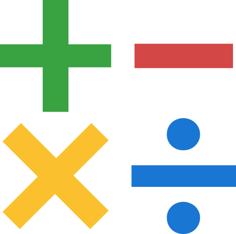
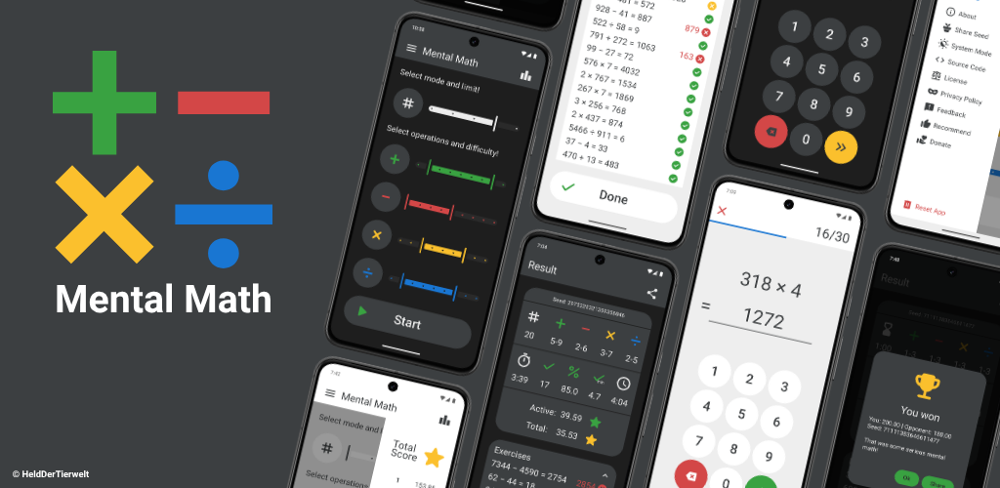

# <a href="https://codeberg.org/Mental-Math/MentalMath"></a> Mental Math
<p align="center">
  
</p>


## App Overview
"Mental Math" is a simple and clean Android app for mental arithmetic training. You can practice on your own or challenge friends to compete and improve your skills. The app is open source and respects your privacy.

<p align="center">
  <a href="https://f-droid.org/packages/com.helddertierwelt.mentalmath/">
    
  </a>
  <a href="https://play.google.com/store/apps/details?id=com.helddertierwelt.mentalmath">
    
  </a>
  <a href="https://codeberg.org/Mental-Math/MentalMath/releases">
    
  </a>
</p>

## Features
#### Customizable Training
Select which arithmetic operations to include (+, −, ×, ÷). For each operation, choose from nine difficulty levels to customize your training precisely to your skill level.

#### Two Game Modes
• Task Mode lets you complete a fixed number of tasks (10, 20, 30, 40, or 50).  
• Timed Mode challenges you to solve as many tasks as possible within a time limit (1, 2, 3, 4, or 5 minutes).

#### Challenge your Friends
You can share a game link to:  
*1.* Replay a completed game with the exact same tasks to compare scores with friends.  
*2.* Start a new game with preset settings for a fair and fresh challenge for everyone.

#### Difficulty Calculation
Task difficulty is determined using [algorithms](https://codeberg.org/Mental-Math/MentalMathEvaluator) based on column addition, column subtraction, long multiplication, and long division, creating realistic and well-balanced exercises.

#### Detailed Results
After each game, view a detailed summary that includes your selected settings, your performance (accuracy, speed, and score), and a complete list of all your tasks and answers for review.

#### Personal Leaderboard
Your top 10 results are displayed separately for each combination of settings, allowing you to easily track your progress. You can also review detailed summaries of your top games at any time.

#### Game History
Explore the complete history of all your scored games. You can sort the list by time or numerically to find specific games. Anytime, you can revisit any match to view a detailed summary of its results.

#### Clean Design
A simple and minimalist app design with no unnecessary elements or distractions, designed to keep your focus fully on mental math training. Supports both light and dark modes.

#### Open Source and Privacy
"Mental Math" is fully [open source](https://codeberg.org/Mental-Math/MentalMath), free to use, and does not collect or process any personal data. It requires no permissions, contains no ads, and runs entirely offline to respect your privacy.

## Screenshots
<p align="center">
  
  
  
  
  
  
  
  
  
  
  
  
</p>

## Build Instructions
Clone the repository and navigate to the project directory:

```bash
git clone https://codeberg.org/Mental-Math/MentalMath.git
cd MentalMath
```

Make sure you have the required Android SDK and JDK (Java 17) installed. The project uses multiple product flavors (dev, foss, and play). To build a specific version, use one of the following commands:

```bash
./gradlew assembleDevRelease
./gradlew assembleFossRelease
./gradlew assemblePlayRelease
```

For successful signing, configure the keys in your gradle.properties file (compare signingConfigs in build.gradle.kts). If no keys are provided, the build will be unsigned. Since the original signing keys are private, using your own keys will break the app links. To make them work, follow these steps:

- Replace all instances of “mental-math.codeberg.page” relating to the game links with your own domain.
- On your website, create an assetlinks.json file and place it at https://<your-domain>/.well-known/assetlinks.json
- Add the SHA256 fingerprint of your key to the assetlinks.json like this:

```json
{
  "relation": ["delegate_permission/common.handle_all_urls"],
  "target": {
    "namespace": "android_app",
    "package_name": "com.helddertierwelt.mentalmath",
    "sha256_cert_fingerprints": [
      "YOUR_SHA256_FINGERPRINT"
    ]
  }
}
```

## License Information
Mental Math © 2025 HeldDerTierwelt  
This project is licensed under the [GNU General Public License Version 3 (GPLv3)](https://www.gnu.org/licenses/gpl-3.0.html). The full license text can also be found in the [LICENSE.md]("https://codeberg.org/HeldDerTierwelt/MentalMath/src/branch/main/LICENSE.md") file.  

## Privacy Policy
Your privacy is important. This app does not collect any personal data, does not require any permissions, and does not use any trackers, ads, or third- party services. Your use of the app is completely anonymous.

## Contact
Feel free to contact me for questions, feedback, issues or any other reason:

Alexander Goy  
aka HeldDerTierwelt  
mental_math_app@pm.me

## Donation
If you enjoy this app, you can support me via [Ko-Fi](https://ko-fi.com/mental_math). It means a lot to me ❤️.

<p align="center">
  <br>
  
</p>