#  Mental Math

## App Overview
"Mental Math" is a simple and clean Android app for mental arithmetic training. You can practice on your own or challenge friends to compete and and improve your skills. The app is open source and respects your privacy.

  
  
  

## Features
#### Customizable Training
Select which arithmetic operations to include (+, −, ×, ÷). For each operation, choose from nine difficulty levels to customize your training precisely to your skill level.

#### Two Game Modes
• Task Mode lets you complete a fixed number of tasks (10, 20, 30, 40, or 50).  
• Timed Mode challenges you to solve as many tasks as possible within a time limit (1, 2, 3, 4, or 5 minutes).

#### Difficulty Calculation
Task difficulty is determined using algorithms based on column addition, column subtraction, long multiplication, and long division, creating realistic and well-balanced exercises.

#### Detailed Results
After each game, view a detailed summary that includes your selected settings, your performance (accuracy, speed, and score), and a complete list of all your tasks and answers for review.

#### Personal Leaderboard
Your top 10 results are saved separately for each combination of settings, so you can keep track of your best performances. You can review detailed summaries of your top games at any time.

#### Challenge your Friends
You can share a game link to:  
*1.* Replay a completed game with the exact same tasks to compare scores with friends.  
*2.* Start a new game with preset settings for a fair and fresh challenge for everyone.

#### Open Source and Privacy
"Mental Math" is fully open source, free to use, and does not collect or process any personal data. It requires no permissions, contains no ads, and runs entirely offline to respect your privacy.

#### Clean Design
A simple and minimalist app design with no unnecessary elements or distractions, designed to keep your focus fully on mental math training. Supports both light and dark modes.

## Screenshots

  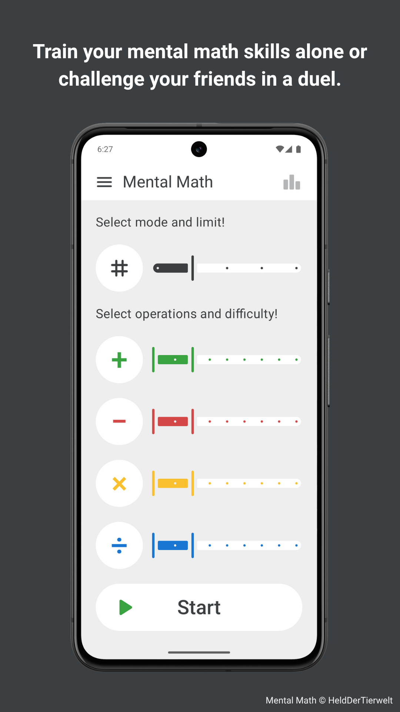
  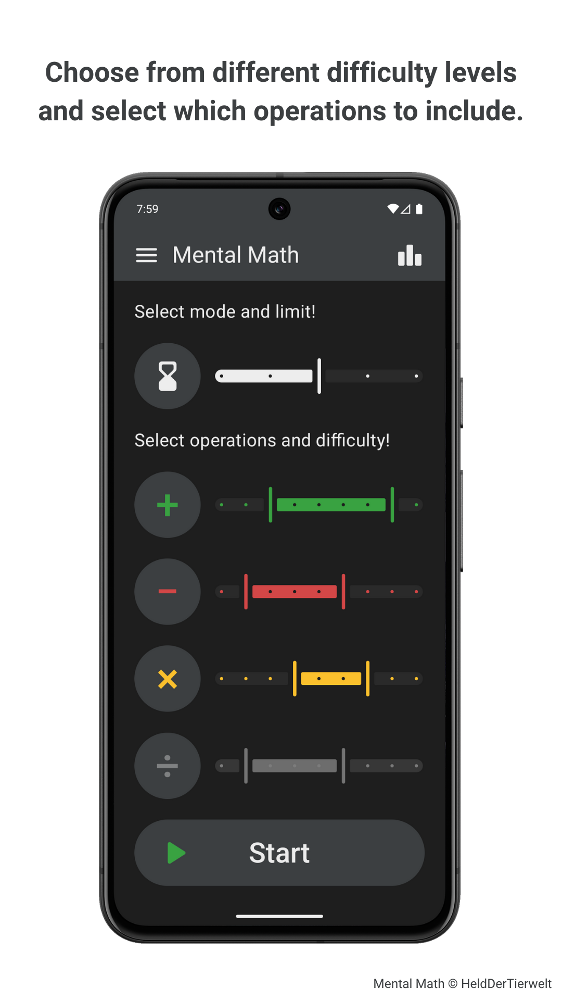
  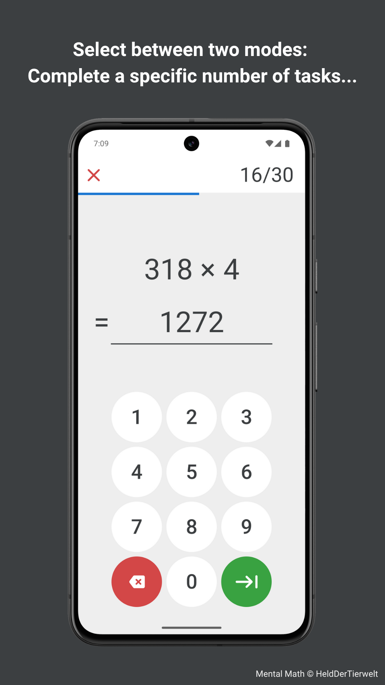
  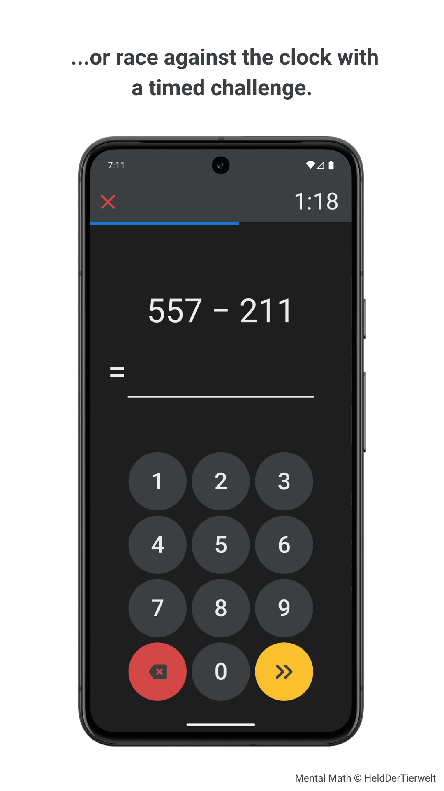
  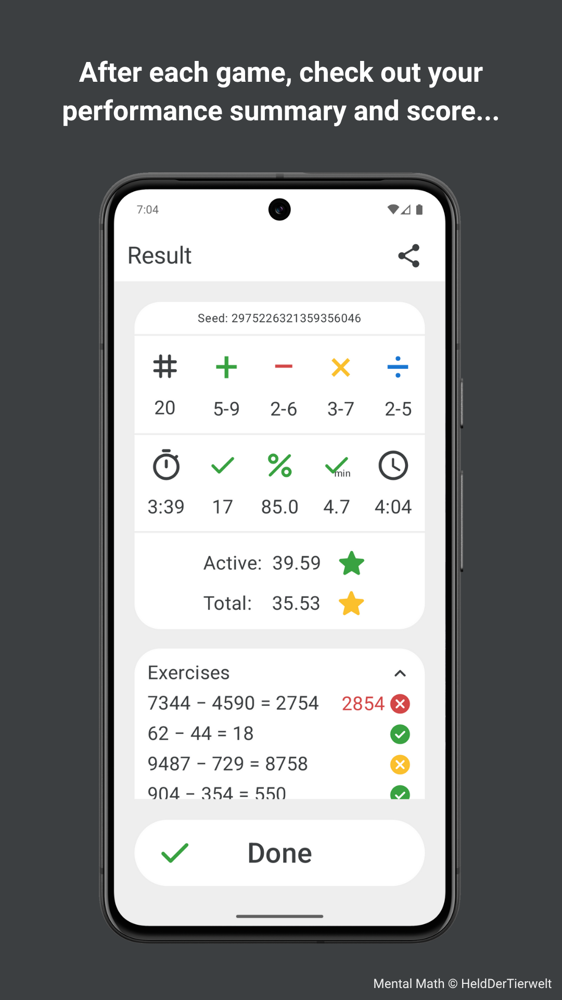
  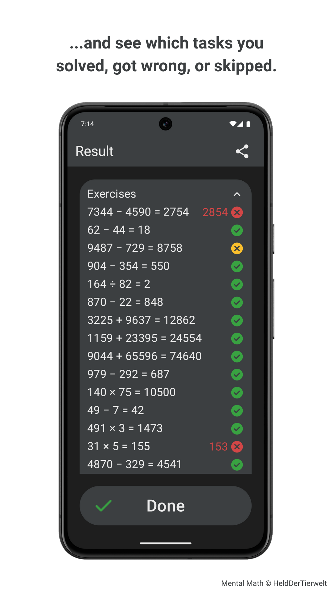
  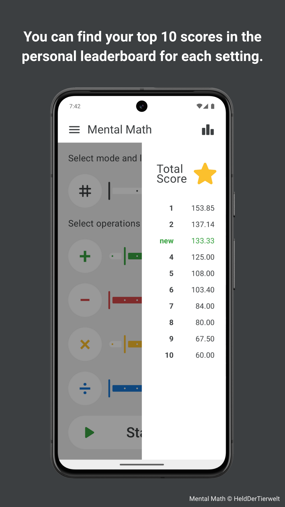
  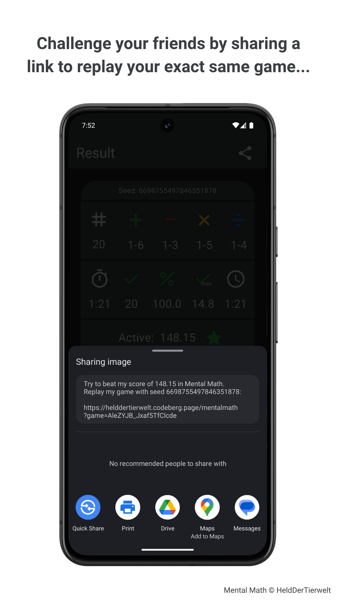
  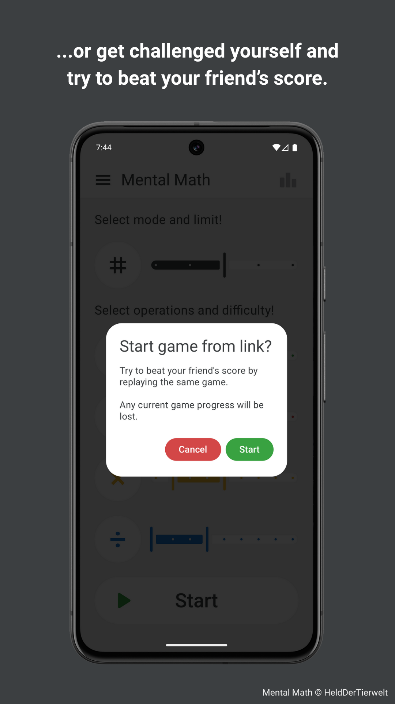
  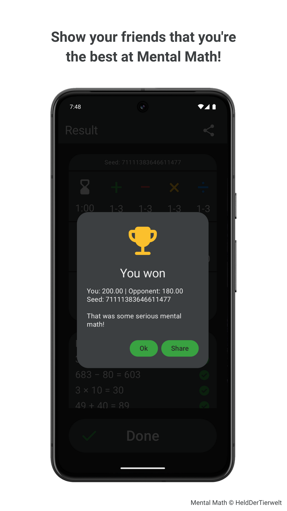
  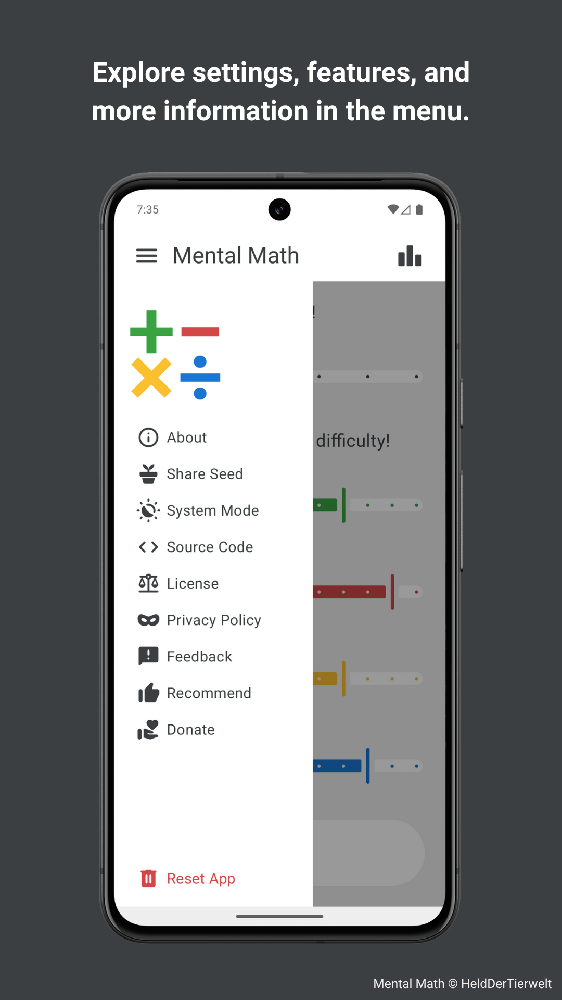

## Privacy Policy
Your privacy is important. This app does not collect any personal data, does not require any permissions, and does not use any trackers, ads, or third- party services. Your use of the app is completely anonymous.

If you have any questions or feedback, feel free to reach out via mental_math_feedback@pm.me.

## License Information
Mental Math © 2025 HeldDerTierwelt  
This project is licensed under the [GNU General Public License Version 3 (GPLv3)](https://www.gnu.org/licenses/gpl-3.0.html). The full license text can also be found in the [LICENSE.md]("https://codeberg.org/HeldDerTierwelt/MentalMath/src/branch/main/LICENSE.md") file.  
  

   
  

